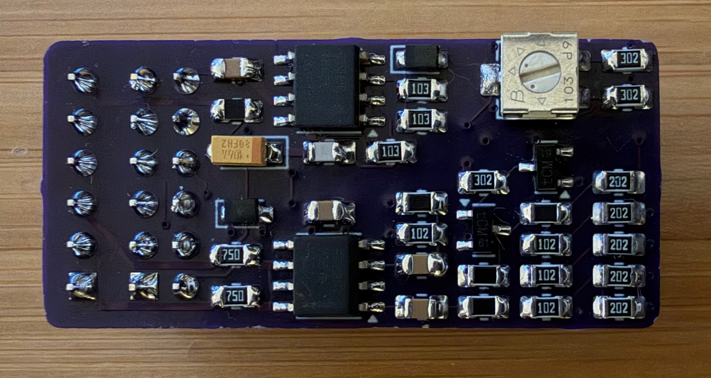
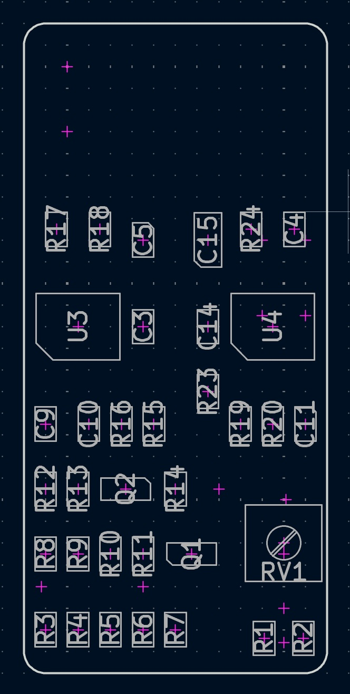
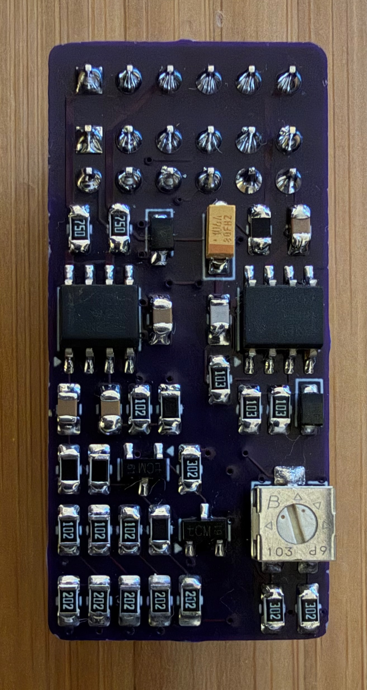
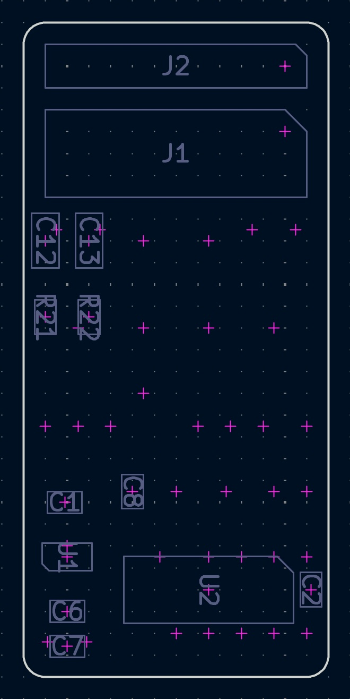
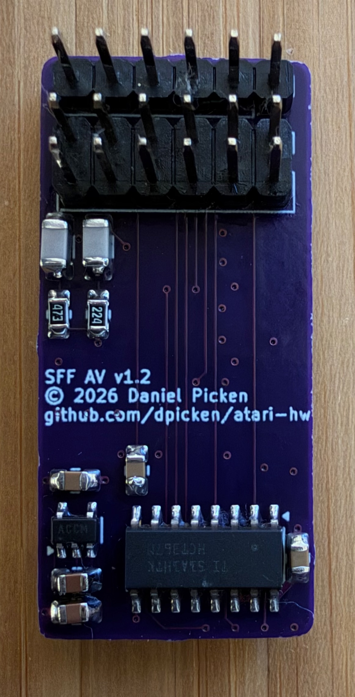

# SFF Audio/Video adapter

Audio/video adapter for the [SFF system](https://github.com/dpicken/atari-hw/blob/master/doc/sbc.md).

- [Schematic](/pdf/sbc-av-schematic.pdf)
- [Layout](/pdf/sbc-av-layout.pdf)
- [Gerber](https://github.com/dpicken/atari-hw/raw/master/gerber/sbc-av.zip)
- [BOM](/pdf/sbc-av-bom.pdf)

# Assembly notes

Ensure the pin headers are installed on the rear of the board.

Reference designators, front:

 

Reference designators, back:

 
